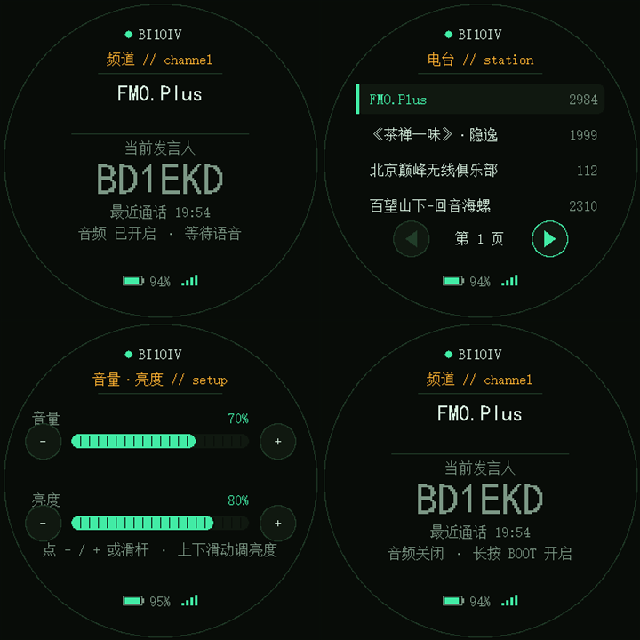

# ESP32 FMO Companion

把 **FMO 电台（APRS / 语音节点）** 的状态搬到一块 1.85 寸圆屏上，并把实时语音拉到板载喇叭播放。

基于 **微雪 ESP32-S3-Touch-LCD-1.85**（ESP32-S3 / 360×360 圆屏 / CST816 触摸 / PCM5101 音频），
纯 ESP-IDF + Arduino 手写 UI，**不用 LVGL**，自带 GB2312 点阵字库。



```
FMO 设备 ──WiFi 局域网── ESP32-S3 ──QSPI──▶ 1.85" 360×360 圆屏
 (fmo.local)               │        ──I²S───▶ PCM5101 → 喇叭
   /ws /events /audio       └──CST816 触摸 / PWR / 电池 ADC
```

---

## ⚡ 快速开始（烧录 + 配置 WiFi，3 步）

**固件不带任何 WiFi 账号，烧完必须配网一次**（不用串口，手机就能配）：

| 步骤 | 做什么 |
|---|---|
| **1. 烧固件** | `pip install esptool` → `cd firmware` → Windows `.\flash.ps1 -Port COM5`　/　macOS·Linux `./flash.sh /dev/ttyACM0` |
| **2. 配 WiFi** | 板子开机自动开热点 **`FMO-Companion`**（2.4 GHz，无密码）→ 手机连它 → 浏览器打开 **`192.168.4.1`** → 选你的 WiFi、填密码 →（可填 FMO 地址，不填就用 `fmo.local`）→ 保存并重启 |
| **3. 收工** | 板子重启后自动联网，屏幕显示频道名与发言人；长按 **BOOT** 开/关语音 |

> 屏幕只支持 **2.4 GHz** 的 WiFi；5 GHz 的 SSID 连不上（选 2.4 GHz 的那个）。
> 以后要换 WiFi / 换 FMO 设备：**断电 → 按住 BOOT 再上电**，或串口发 `wifireset`，会重新进配网模式。
> 也可以在 `src/FmoCompanion/Config.h` 里把 `WIFI_SSID` / `WIFI_PASS` 写死后编译，见 [2.3](#23-配网两种方式任选)。

---

## 1. 功能

| 屏 | 内容 |
|---|---|
| **① 频道 channel** | 顶部居中显示本机呼号；当前频道名（中文 24 px）；**当前发言人**（48 px 呼号，讲话时绿色圆点 + "正在讲话"，无推送时灰显"最近通话"）；一行音频状态（`音频 LIVE` / `等待语音` / `音频关闭 · 长按 BOOT 开启`） |
| **② 电台 station** | 台站列表，4 条/页，两侧 `‹` `›` 翻页（第 N 页，到首页/末页箭头变暗）；**点两次**才真正切换电台（第一次琥珀色选中），避免误触 |
| **③ 音量·亮度 setup** | 两条滑杆：音量（音频增益 0–100%）、亮度（背光 5–100%）；点 `-`/`+` 步进 10，或直接点滑杆定位 |

**操作**

| 手势 / 按键 | 动作 |
|---|---|
| 左右滑动 | 切屏（3 页循环，160 ms 淡出→淡入） |
| 上下滑动 | 任意页调背光 |
| **长按 BOOT（GPIO0，700 ms）** | **开 / 关实时语音**（唯一开关入口） |
| 单击 | 电台页 `‹` `›` 翻页 / 台站行（两次确认） |
| 长按 PWR 20 s | 断电 |

**掉电保持（NVS）**：亮度、音频开关、音量、WiFi、FMO 地址全部记住，重新上电自动恢复
（上次音频是开着的，开机自动重连 `/audio`）。

---

## 2. 烧录

### 2.1 直接烧预编译固件（推荐，不用装编译环境）

预编译固件在 `firmware/`，**不含任何 WiFi 凭据**（配网见 2.3）。

**Windows（需要 Python + esptool）**

```powershell
pip install esptool
cd firmware
.\flash.ps1 -Port COM5          # 端口号按设备管理器里实际的写
```

**macOS / Linux**

```bash
pip3 install esptool
cd firmware
chmod +x flash.sh
./flash.sh /dev/ttyACM0         # macOS 通常是 /dev/cu.usbmodem*
```

脚本做的事（等价于手工命令，地址不能错）：

| 地址 | 文件 |
|---|---|
| `0x0` | `bootloader.bin` |
| `0x8000` | `partitions.bin`（3 MB app + 9 MB FAT，单 app 无 OTA） |
| `0xe000` | `boot_app0.bin` |
| `0x10000` | `fmo-companion-app.bin` |

```bash
esptool.py --chip esp32s3 --baud 921600 \
  --before default_reset --after hard_reset \
  write_flash --flash_mode dio --flash_size 16MB --flash_freq 80m \
  0x0 bootloader.bin 0x8000 partitions.bin 0xe000 boot_app0.bin 0x10000 fmo-companion-app.bin
```

> 板子两个 Type-C 口都行；烧录时如果提示连不上，按住 **BOOT** 再点一下 **RST** 进下载模式。

### 2.2 从源码编译

需要 [arduino-cli](https://arduino.github.io/arduino-cli/) 与 **esp32 core 3.1.1**：

```bash
arduino-cli core install esp32:esp32@3.1.1
```

然后（仓库根目录）：

```powershell
.\build\build.ps1              # 编译
.\build\build.ps1 -Upload      # 编译 + 烧录
.\build\build.ps1 -Upload -Port COM5
```

`build.ps1` 用的 FQBN（必须一致，否则屏幕/音频引脚对不上）：

```
esp32:esp32:waveshare_esp32_s3_touch_lcd_185:PartitionScheme=app3M_fat9M_16MB,CDCOnBoot=cdc,USBMode=hwcdc,UploadSpeed=921600
```

依赖只有 `libs/ArduinoJson`（单头文件，已随仓库提供）。

### 2.3 配网（两种方式，任选）

固件出厂**不带任何 WiFi 账号**。第一次开机如果没配网，会自动进入「配网模式」：

```
① 手机连热点   FMO-Companion     （2.4 GHz，无密码）
② 浏览器打开   192.168.4.1       （连上通常会自动弹出）
③ 选你的 WiFi、填密码、（可选）填 FMO 地址 → 保存并重启
```

屏幕上会同步显示这三步。**注意 ESP32 只支持 2.4 GHz**，5 GHz 的 SSID 连不上。

**以后想重配**（换路由器 / 密码改了 / 想换 FMO 设备）：

- 断电，**按住 BOOT 再上电**（按住约 2 秒），就会重新进配网模式；或
- 串口（115200）发 `wifireset` 清空并重启进配网；或
- 串口直接发 `wifi 你的SSID 你的密码`（最快，不用手机）。

**FMO 设备地址**可以留空：固件默认用 mDNS 名 **`fmo.local`** 解析（FMO 官方 App 用的也是这个名字）。
网络里 mDNS 被禁用（部分路由器 / AP 隔离）时，才需要在配网页或串口 `host 192.168.50.163` 指定固定 IP。
这些都能写在 `src/FmoCompanion/Config.h` 里再编译（`WIFI_SSID` / `WIFI_PASS` / `FMO_FALLBACK_IP`）。

---

## 3. 用起来

- 屏幕第一屏就是「频道 + 当前发言人」；有人讲话时呼号变大变绿，同时喇叭出声（音频开着的话）。
- **长按 BOOT** 开关音频，屏幕上会弹 `音频已开启 / 音频已关闭`；这个状态会记住。
- 第二屏是台站列表：`‹` `›` 翻页，点一下选中（琥珀色）、再点一下才切过去（防误触）。
- 第三屏调音量/亮度，滑杆和 `-`/`+` 都能用，同样会记住。

---

## 4. 调试

板子联网后有一个 **TCP 命令行**（USB 掉线也能用）：

```
telnet <板子IP> 2323
```

| 命令 | 作用 |
|---|---|
| `stat` | 链路 / 频道 / 发言人 / 音频 / 电池 / 堆 |
| `shot` | 把帧缓冲以文本吐出（配合 `tools/shot2png.ps1` 转 PNG） |
| `page 0\|1\|2` | 跳屏 |
| `tap X Y` / `swipe l\|r` | 模拟触摸 |
| `tone [ms]` | 喇叭自检（1 kHz 正弦，默认 1 s） |
| `audio 0\|1` / `gain N` / `bright N` | 音频 / 音量 / 背光 |
| `srot 0..3` | 屏幕方向 0°/90°/180°/270°（默认 180°） |
| `wifi SSID PASS` / `wifireset` / `host IP` | 配网 / 清空配网并进门户 / 指定 FMO 地址（都持久保存） |
| `refresh` / `prep` / `reboot` | 重拉数据 / 烧录前礼貌断连 / 重启 |

`tools/` 里有 `snapnet.ps1`（TCP 抓屏）、`shot2png.ps1`（抓屏转 PNG）。

---

## 5. 协议备忘（逆向设备前端 + 真机验证）

FMO 设备**无鉴权**，纯 WebSocket JSON：

```json
{"type":"station","subType":"getCurrent","data":{}}                    // 请求
{"type":"station","subType":"getCurrentResponse","data":{...},"code":0} // 响应
```

- 三条通道：`/ws`（请求响应）、`/events`（只推）、`/audio`（**裸 PCM16 LE / 单声道 / 8000 Hz**，有声才推流）
- 没有 request id、单锁串行、忙时直接丢请求 → 客户端要做**单飞队列 + 超时重发**
- 响应可能被拆成多帧（按 FIN 重组）；客户端帧必须**整帧一次写出**
- 本固件用到：`user/getInfo`、`station/getCurrent`、`station/getListRange`、`station/setCurrent`、`qso/getList`、`/events` 的 `qso` 推送
- ⚠️ 坑：`station/getListRange` 的响应 subType 是 **`getListResponse`**（不是 `getListRangeResponse`）

---

## 6. 已知问题

1. **FMO 的 WebSocket 槽位有限（约 7 个）且不回收半开连接**：反复硬复位会把它占满（ping 通但 80 端口不响应），只能给 FMO 断电。烧录前先发 `prep` 让板子礼貌发 close 帧能大幅缓解。
2. **这块板的 USB-Serial-JTAG 偶发卡死**（COM 口消失 / 写超时，但 WiFi 仍活）：拔插 Type-C 或按 RST；日常调试可只用 TCP 2323。
3. **触摸芯片 CST816 偶发"幽灵手势"**（无按压也报手势）：固件已加"最近 500 ms 真的按到面板"门限，切台/发消息这类写操作一律两次确认。
4. 音频通路（`/audio → 环形缓冲 → 增益 → I²S`）已用 `tone` 自检验证；**喇叭音量/音质仍需按实际听感调 `gain`**。
5. 分区表 3 MB 单 app，**无 OTA**。

---

## 7. 目录

```
src/FmoCompanion/    固件源码（含 GB2312 点阵字库与屏幕/触摸驱动）
firmware/            预编译固件 + 烧录脚本
libs/ArduinoJson/    依赖（单头文件）
build/build.ps1      编译/烧录脚本
tools/               调试小工具（抓屏、转 PNG）
docs/                截图
```

主要模块：`FmoCompanion.ino`（初始化/触摸/命令）、`FmoClient`（WebSocket 请求队列与解析）、
`WsClient`（极简 WS 客户端）、`AudioOut`（I²S）、`Ui`（3 屏界面）、`Gfx`（自绘图形层）、
`Settings`（NVS 持久化）。

---

## 8. 许可与致谢

- 本项目代码：MIT（见 `LICENSE`）
- `src/FmoCompanion/Display_ST77916.*`、`esp_lcd_st77916.*`、`Touch_CST816.*`、`TCA9554PWR.*`、
  `I2C_Driver.*`、`PWR_Key.*`、`BAT_Driver.*` 来自 **微雪（Waveshare）官方示例**，版权归其所有，按其示例许可使用
- [ArduinoJson](https://arduinojson.org/)（MIT）
- 字库由 Windows 宋体/黑体点阵化生成（仅作点阵数据使用）

> 固件里不包含任何 WiFi 凭据；发布者请注意不要把自己 `Config.h` 里的 SSID/密码提交上去。
